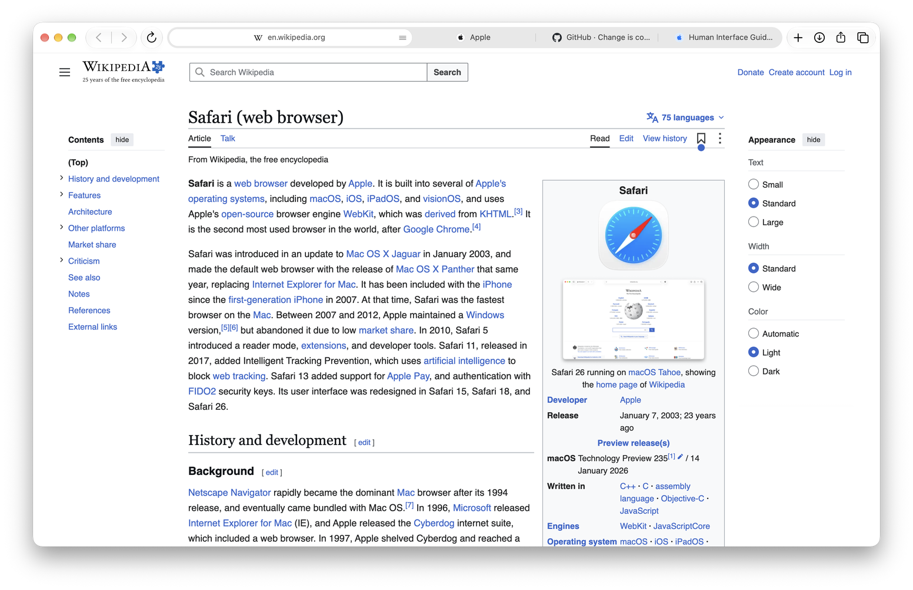

<p align="center">
  
</p>

# Safarium

Safarium is a macOS web browser that pairs the Chromium engine with a native AppKit interface modelled on Safari 27. The tab bar, toolbar, sidebar and tab overview are written in AppKit and use the system's Liquid Glass. Pages, extensions and settings come from Chromium, so Chrome Web Store extensions work.



## Animation

Motion is a first-class part of Safarium. Each transition was timed frame by frame against screen recordings of Safari and tuned to match its curves:

- **Tabs.** Opening, closing, switching and dragging tabs slide every tab to its new place, and the tab strip grows and shrinks smoothly when tabs come and go.
- **Address field.** When you start editing, the site name stays put while the full address grows around it and slides into place; the favicon glides between the centre and the edge.
- **Tab menu.** Right-click a tab, the address field or a Tab Overview card for Safari's tab menu: pin, mute, copy link, duplicate, arrange tabs by title or website, move to a new window, and close tabs. Right-click an extension's button to manage it or remove it from the toolbar.

**Tab Overview.** The current page shrinks into its card in the grid and grows back out of whichever card you pick, and the address field fades into a search field.

In one place Safarium goes further than Safari:

- **Full screen video.** The video grows from its place in the page and shrinks back while it keeps playing. Sites that resize their own player after full screen, such as YouTube, are waited for, so there's no flash of a mis-sized video on the way back, which Safari itself shows on YouTube.

The interface and its animations will keep being refined.

## Features

**Compact tab bar.** Tabs share one row with the address field, as in Safari's compact layout. The current tab is the address field. Tabs show hover cards, can be dragged to reorder, and can be torn off into a new window.

**Vertical tabs.** View › Show Tabs Vertically, or Settings › Tabs, moves the tabs into a left sidebar. Drag the sidebar's right edge to resize it. The window controls and toolbar buttons sit at its top.


**Customizable sidebar toolbar.** Right-click an empty part of the sidebar and choose **Customize Toolbar…**. Drag buttons in from the palette, move them, or drag them out. A space starts a new group, a flexible space pushes what follows to the right, and dropping below the buttons starts a new row. The horizontal toolbar keeps its own layout through the standard macOS **Customize Toolbar…** sheet.


**Tab Overview.** The overview button shows every tab as a card. The page zooms into its card and back out, and the search field filters tabs.


**Full screen video.** A video goes into its own full-screen space and returns to where you were, the desktop or a full-screen browser window.

**Bookmarks.** ⌘D opens Safari's Add Bookmark panel from the address field: pick a folder, edit the title, then Add. Nothing is saved if you cancel. On a page that is already bookmarked the panel edits or removes that bookmark.

**Passwords and autofill.** Safarium offers to save passwords and addresses after you submit a form and fills them in later, with a bubble under the address field. Right-click a page to make a QR code for it.

**Settings.** Safarium › Settings… opens a native settings window with General, Tabs, AutoFill and Advanced panes. Show All Settings… opens Chromium's full settings in a tab.

**Full screen.** In the compact layout, View › Always Show Toolbar in Full Screen keeps the tab bar visible in full screen; otherwise it slides down when you move to the top of the screen. The vertical sidebar always stays.

**Reopen your last session.** History › Reopen All Windows from Last Session brings back the windows and tabs from before you quit, or from before a crash.

**Downloads on quit.** Quitting or closing the last window while a download is in progress asks first.

**New Tab shortcuts.** The New Tab page holds up to 20 shortcuts.

**Extensions.** Install extensions from the Chrome Web Store. Their buttons can go on either toolbar, and side panel extensions such as Claude open in a panel on the right of the page.

## Install

Safarium runs on Apple silicon Macs with macOS 26 or later. It is built and tested on macOS 27.2.

1. Download the latest `Safarium-<version>-arm64.dmg` from [Releases](../../releases).
2. Open it and drag **Safarium** into **Applications**.
3. The app is signed ad hoc and not notarized, so the first launch shows **"Safarium.app" Not Opened**. Click **Done** (not Move to Trash), then either:
   - open **System Settings › Privacy & Security**, scroll to the message about Safarium, click **Open Anyway** and confirm, then open Safarium again and choose **Open Anyway**; or
   - run this once in Terminal:

     ```sh
     xattr -dr com.apple.quarantine /Applications/Safarium.app
     ```

   Right-click › Open no longer bypasses this check on macOS 15 and later.

To update, quit Safarium and replace the app with the one from the newer DMG, then repeat step 3 for the new copy. Bookmarks, history, passwords and extensions are stored in `~/Library/Application Support/Safarium` and are kept. macOS may ask once more for permission to use the "Safarium Safe Storage" keychain item.

## Limitations

- No automatic updates. Each release is a new DMG, and Chromium security fixes arrive only with a new Safarium build.
- No Google account sign-in or sync, since the build has no Google API keys. For the same reason page translation, Google Lens and the "AI in Chrome" features are left out.
- No Cast.
- Apple silicon only.

## Build from source

Safarium is a patch series on top of Chromium **160.0.8167.0** (commit [`b9e18363aa69`](https://chromium.googlesource.com/chromium/src/+/b9e18363aa69f9e9e836a67fcfbb334c3dcf4598)). Building it needs Chromium's usual macOS toolchain: Xcode with the macOS 26 SDK or later, [depot_tools](https://commondatastorage.googleapis.com/chrome-infra-docs/flat/depot_tools/docs/html/depot_tools_tutorial.html), and roughly 100 GB of disk.

```sh
# 1. Check out Chromium at the base revision.
mkdir chromium && cd chromium
fetch --nohooks chromium
cd src
git checkout b9e18363aa69f9e9e836a67fcfbb334c3dcf4598
gclient sync -D

# 2. Apply the Safarium patches (creates a `safarium` branch).
/path/to/Safarium/scripts/apply-patches.sh "$PWD"

# 3. Configure and build.
mkdir -p out/Release
cp /path/to/Safarium/build/args.gn out/Release/args.gn
gn gen out/Release
autoninja -C out/Release chrome

# 4. Package an ad hoc signed DMG into ~/chromium/dist.
SAFARIUM_SRC="$PWD" /path/to/Safarium/scripts/package-safarium.sh
```

`build/args.gn` builds the branded, standalone release app with proprietary codecs (H.264/AAC playback). With a Developer ID you can sign and notarize through Chromium's `sign_chrome.py --identity <ID> --notarize` instead of the packaging script.

## Repository layout

| Path | Contents |
| --- | --- |
| `patches/` | The Safarium changes as `git format-patch` files, applied in order |
| `build/args.gn` | GN arguments for the release build |
| `scripts/apply-patches.sh` | Applies the patches to a checkout at the base revision |
| `scripts/package-safarium.sh` | Signs the release app ad hoc and builds the DMG |

## License

Safarium's changes are released under the same BSD-style license as Chromium (see [LICENSE](LICENSE)). Chromium and its third-party components keep their own licenses, listed in the app at `chrome://credits`. Safarium is an independent project and is not affiliated with Apple or Google.
