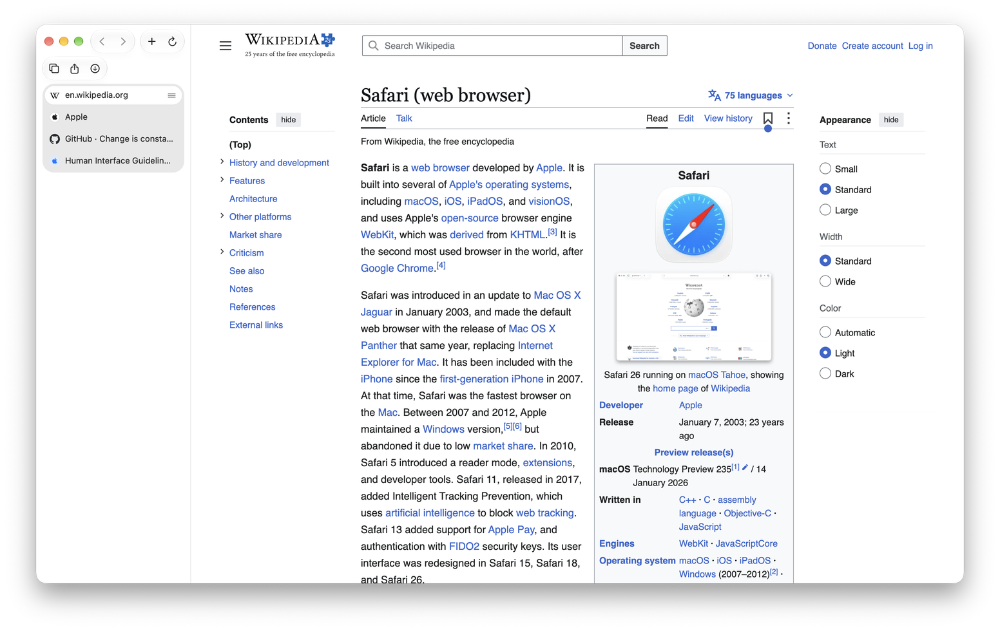
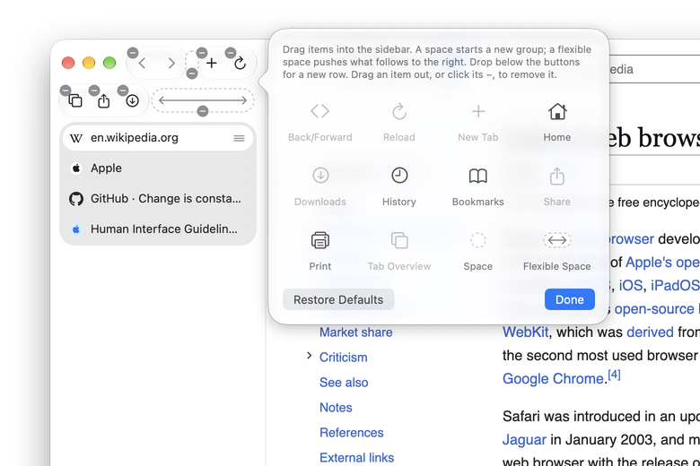
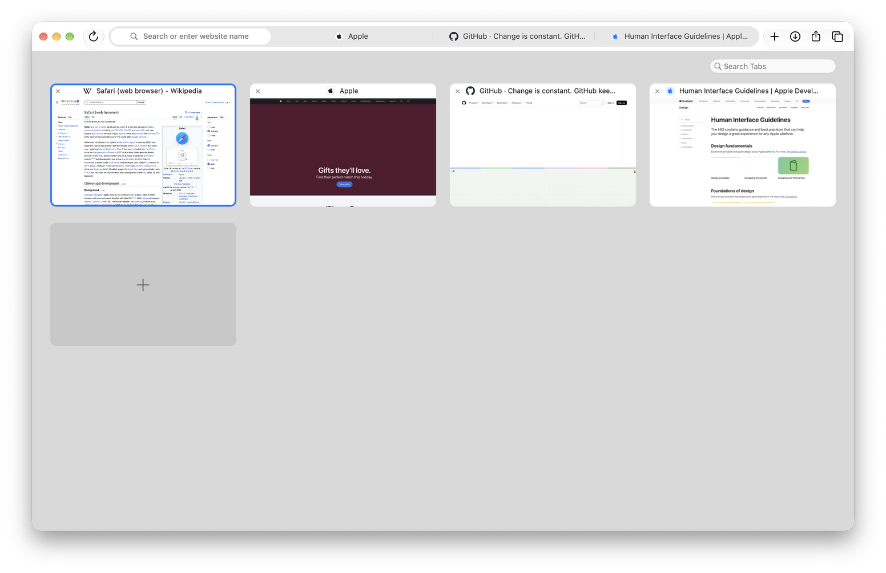

# Safarium

Safarium is a macOS web browser that pairs the Chromium engine with a native AppKit interface modelled on Safari 27. The tab bar, toolbar, sidebar and tab overview are written in AppKit and use the system's Liquid Glass. Pages, extensions and settings come from Chromium, so Chrome Web Store extensions work.


## Features

**Compact tab bar.** Tabs share one row with the address field, as in Safari's compact layout. The current tab is the address field. Tabs show hover cards, can be dragged to reorder, and can be torn off into a new window.

**Vertical tabs.** Settings › Appearance › Tab position moves the tabs into a left sidebar. Drag the sidebar's right edge to resize it. The window controls and toolbar buttons sit at its top.



**Customizable sidebar toolbar.** Right-click an empty part of the sidebar and choose **Customize Toolbar…**. Drag buttons in from the palette, move them, or drag them out. A space starts a new group, a flexible space pushes what follows to the right, and dropping below the buttons starts a new row. The horizontal toolbar keeps its own layout through the standard macOS **Customize Toolbar…** sheet.



**Tab Overview.** The overview button shows every tab as a card. The page zooms into its card and back out, and the search field filters tabs.



**Extensions.** Install extensions from the Chrome Web Store. Their buttons can go on either toolbar, and side panel extensions such as Claude open in a panel on the right of the page.

## Install

Safarium runs on Apple silicon Macs with macOS 26 or later. It is built and tested on macOS 27.2.

1. Download the latest `Safarium-<version>-arm64.dmg` from [Releases](../../releases).
2. Open it and drag **Safarium** into **Applications**.
3. The app is signed ad hoc and not notarized, so macOS blocks the first launch. Right-click Safarium in Applications, choose **Open**, then **Open** again. Alternatively run:

   ```sh
   xattr -dr com.apple.quarantine /Applications/Safarium.app
   ```

To update, quit Safarium and replace the app with the one from the newer DMG. Bookmarks, history, passwords and extensions are stored in `~/Library/Application Support/Safarium` and are kept. macOS may ask once more for permission to use the "Safarium Safe Storage" keychain item.

## Limitations

- No automatic updates. Each release is a new DMG, and Chromium security fixes arrive only with a new Safarium build.
- No Google account sign-in or sync, since the build has no Google API keys.
- Apple silicon only.

## Build from source

Safarium is a patch series on top of Chromium **160.0.8167.0** (commit [`b9e18363aa69`](https://chromium.googlesource.com/chromium/src/+/b9e18363aa69f9e9e836a67fcfbb334c3dcf4598)). Building it needs Chromium's usual macOS toolchain: Xcode with the macOS 26 SDK or later, [depot_tools](https://commondatastorage.googleapis.com/chrome-infra-docs/flat/depot_tools/docs/html/depot_tools_tutorial.html), and roughly 100 GB of disk.

```sh
# 1. Check out Chromium at the base revision.
mkdir chromium && cd chromium
fetch --nohooks chromium
cd src
git checkout b9e18363aa69f9e9e836a67fcfbb334c3dcf4598
gclient sync -D

# 2. Apply the Safarium patches (creates a `safarium` branch).
/path/to/Safarium/scripts/apply-patches.sh "$PWD"

# 3. Configure and build.
mkdir -p out/Release
cp /path/to/Safarium/build/args.gn out/Release/args.gn
gn gen out/Release
autoninja -C out/Release chrome

# 4. Package an ad hoc signed DMG into ~/chromium/dist.
SAFARIUM_SRC="$PWD" /path/to/Safarium/scripts/package-safarium.sh
```

`build/args.gn` builds the branded, standalone release app with proprietary codecs (H.264/AAC playback). With a Developer ID you can sign and notarize through Chromium's `sign_chrome.py --identity <ID> --notarize` instead of the packaging script.

## Repository layout

| Path | Contents |
| --- | --- |
| `patches/` | The Safarium changes as `git format-patch` files, applied in order |
| `build/args.gn` | GN arguments for the release build |
| `scripts/apply-patches.sh` | Applies the patches to a checkout at the base revision |
| `scripts/package-safarium.sh` | Signs the release app ad hoc and builds the DMG |

## License

Safarium's changes are released under the same BSD-style license as Chromium (see [LICENSE](LICENSE)). Chromium and its third-party components keep their own licenses, listed in the app at `chrome://credits`. Safarium is an independent project and is not affiliated with Apple or Google.
